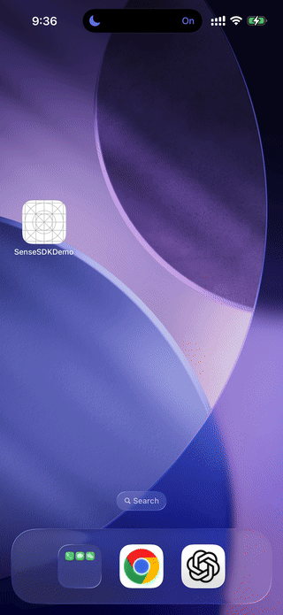

# sense-sdk-kit

Everything an OEM partner needs to build on the Coiliiot Sense platform:
BLE gateway provisioning, gateway/sensor registration, and reading sensor
data, backed by Coiliiot's staging sandbox (`coiliiot-sense-staging`), not
production.

This repo ships **compiled** SDKs and full documentation, not source —
see each platform's own README for install/usage details and its own
demo app to copy from freely.

## React Native

- **[`react-native/sdk/`](react-native/sdk)** — compiled JS + type
  declarations (`lib/`), the packed installable tarball, and the full
  [API README](react-native/sdk/README.md). No TypeScript source.
- **[`react-native/demo/`](react-native/demo)** — a complete,
  buildable reference app. See
  [`react-native/demo/README.md`](react-native/demo/README.md) for
  setup, the test account, and troubleshooting.

## Android

- **[`android/sdk/`](android/sdk)** — the compiled `.aar` and the full
  [API README](android/sdk/README.md). No Kotlin source.
- **[`android/demo/`](android/demo)** — a complete, buildable native
  Kotlin/Compose reference app exercising the same flow as the RN
  demo, and verified end to end on real hardware. See
  [`android/demo/README.md`](android/demo/README.md) for setup, the test
  account, and what that real-device pass found.

This is for OEM partners building a native (or Kotlin Multiplatform)
Android app instead of React Native — a native Android library plugs
into a KMP app directly, with no bridge needed.

## iOS

- **[`ios/sdk/`](ios/sdk)** — the compiled `CoiliiotSenseSDK.xcframework`
  and the full [API README](ios/sdk/README.md). No Swift source, and no
  peer dependencies to add — unlike Android/React Native, Firebase is
  compiled directly into the framework.
- **[`ios/demo/`](ios/demo)** — a complete, buildable native SwiftUI
  reference app exercising the same flow as the other two demos, and
  verified end to end on real hardware. See
  [`ios/demo/README.md`](ios/demo/README.md) for setup, the test account,
  and what that real-device pass found.

This is for OEM partners building a native iOS app instead of React
Native. Read [`ios/sdk/README.md`](ios/sdk/README.md)'s note on Firebase
before integrating if your own app also uses Firebase for anything else.

## Distribution

Every platform ships from a [GitHub Release](../../releases) with its
compiled artifact attached (the iOS one as a zipped `.xcframework`), so
you don't need repo tree access to grab a copy — see each platform's own
README for the exact install command.
